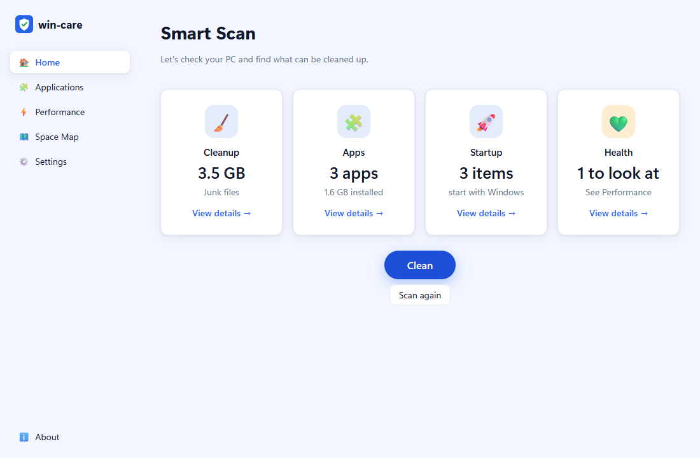
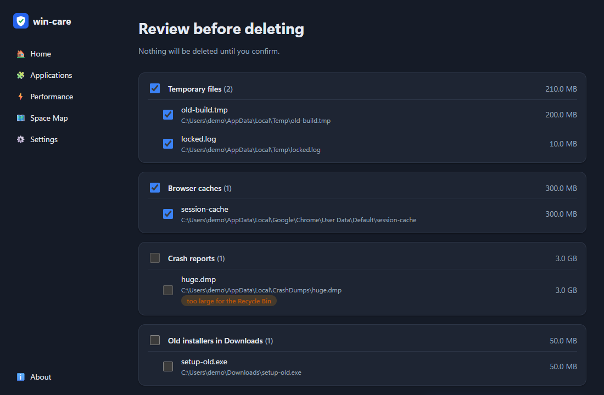
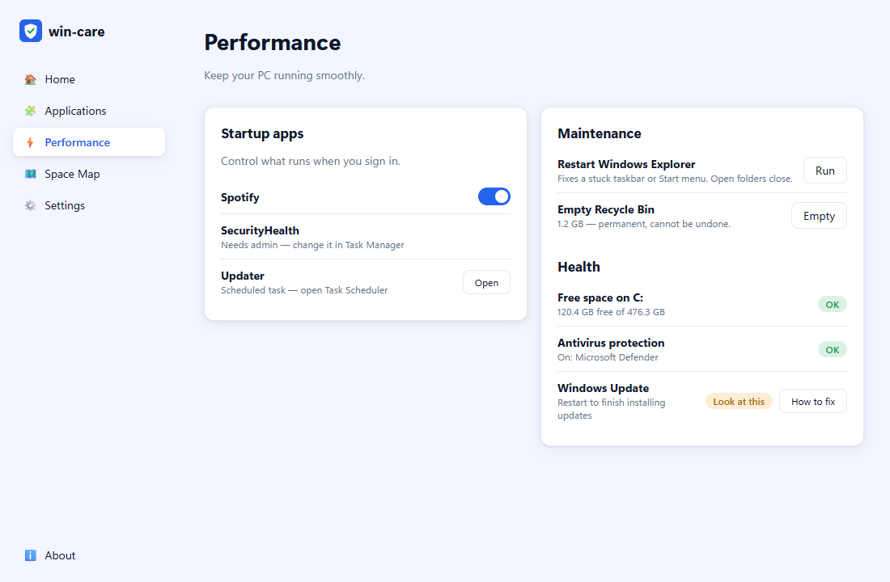
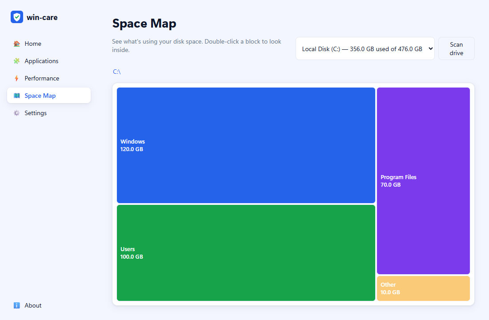
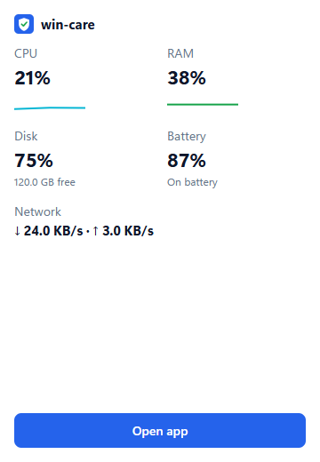

  

<h1 align="center">win-care</h1>

  <strong>A free, open-source PC care app for Windows.</strong> 
  Find junk, free up space, remove apps cleanly and keep an eye on your PC — from the tray.

  
  
  
  
  

  

> **Status: early (v0.1).** It works and it is careful, but it is young. Builds are not
> code-signed yet, so Windows warns about the installer. See the [roadmap](ROADMAP.md).

## Why win-care?

Most "PC cleaners" scare you with red alerts, inflate numbers and delete things you never saw.
win-care is the opposite:

- **You see everything before anything changes.** Every item is listed with its size; you tick
  what goes.
- **Deletes go to the Recycle Bin.** Changed your mind? Restore it. win-care can never silently
  turn a "move to Recycle Bin" into a permanent delete.
- **Your files are off-limits.** Documents, Desktop, Pictures, Music, Videos, Windows and Program
  Files are never offered for deletion.
- **No admin rights, no account, no telemetry, no ads.** Nothing leaves your PC.
- **Small and fast.** A ~3.5 MB installer, written in Rust.

Read the full [safety model](docs/SAFETY.md).

## Features

|                            |                                                                                                                                                                          |
| -------------------------- | ------------------------------------------------------------------------------------------------------------------------------------------------------------------------ |
| **Smart Scan**             | One scan across junk files, installed apps, startup items and PC health. One **Clean** button.                                                                           |
| **Review before deleting** | Grouped list with sizes and checkboxes. Old installers are never pre-selected; items too big for the Recycle Bin are marked and skipped.                                 |
| **Applications**           | Uninstall with the app's own uninstaller, then review what it left behind.                                                                                               |
| **Performance**            | Switch startup apps on and off (the same switch Task Manager uses), restart Explorer, empty the Recycle Bin, check disk health, antivirus, firewall and pending updates. |
| **Space Map**              | A treemap of what uses your disk; double-click to drill in.                                                                                                              |
| **Tray popup**             | Live CPU, RAM, disk, battery and network, one useful tip, and the app one click away.                                                                                    |
| **Light and dark**         | Follows Windows, or pick one.                                                                                                                                            |

  
  

  
  

## Install

1. Download `win-care_<version>_x64-setup.exe` from
   [Releases](https://github.com/esraa-emadeldin/win-care/releases).
2. Run it. It installs **for your user only** — no admin rights needed.
3. win-care opens and lives in the tray (bottom-right). Click the icon for the popup.

Uninstall any time from **Windows Settings → Apps**.

**"Windows protected your PC"?** Builds are not code-signed yet (it is on the
[roadmap](ROADMAP.md)), so SmartScreen warns about the installer: choose **More info → Run anyway**.
PCs with **Smart App Control** turned on block unsigned apps entirely until signing lands.

Needs Windows 11, or Windows 10 22H2, 64-bit.

## FAQ

**Will it delete my files?** Only what you tick, after you see it, and only into the Recycle Bin.
Your personal folders are never offered.

**Why doesn't it clean `C:\Windows\Temp` or the Windows Update cache?** Those need admin rights,
and v0.1 never asks for them. A safe way to do it is planned for v0.3.

**Does it make my PC faster?** It frees disk space and lets you stop apps from starting with
Windows. It does not promise magic: no "RAM boosters", no registry "cleaning".

**Does it phone home?** No. The only network use is an optional, off-by-default daily update check.

## Contributing

Contributions of every size are welcome — code, translations, docs, bug reports, design.
Start with [CONTRIBUTING.md](CONTRIBUTING.md); issues labelled
[`good first issue`](https://github.com/esraa-emadeldin/win-care/labels/good%20first%20issue)
are a gentle start. Please follow the [Code of Conduct](CODE_OF_CONDUCT.md).

- How it works inside: [docs/ARCHITECTURE.md](docs/ARCHITECTURE.md)
- Where it is going: [ROADMAP.md](ROADMAP.md)
- Found a security problem? See [SECURITY.md](SECURITY.md) — please don't open a public issue.

## Releasing (maintainers)

Push a `v*` tag; the Release workflow builds the installer and a signed update manifest into a
**draft** release. It needs the repository secret `TAURI_SIGNING_PRIVATE_KEY` — the updater
private key, kept outside the repository and never committed.

## Acknowledgements

The cleanup and tools ideas come from [zc-care](https://github.com/ZoolCoder/zc-care), a macOS
app. win-care is an independent Windows app with its own code.

## Licence

[MIT](LICENSE)
