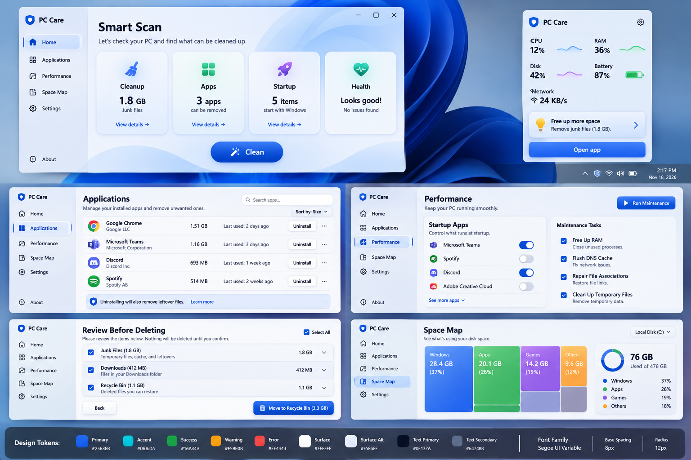
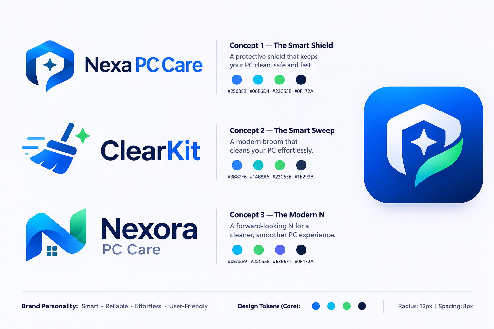

---

## 2026-11-18 01:50 · redesign

Sent: shots/01-smart-scan.png, shots/02-tray-panel.png, shots/03-applications.png, shots/04-performance.png

Prompt

You are a senior product designer. I am going to have you redesign an existing
application. I have attached 4 screenshots of the current UI.

PROJECT BRIEF
## Product

A free, open-source PC care app for Windows 11: it finds junk, frees disk space, removes apps
cleanly and keeps an eye on the PC's health. Working name only; it needs its own identity and
must not imitate CleanMyMac or any existing product's name, logo or look.

The attached screenshots are a macOS app by the same family of tools, given only as a reference
for the feature set and the "cards + one big Run button" idea. Redesign each screen as a native
Windows 11 app (Fluent: Mica background, rounded corners, Segoe UI Variable, light and dark).

Two rules shape every screen:
- Nothing is deleted before the user reviews the exact list of items.
- Deletes go to the Recycle Bin by default, so they can be undone.

## Users

Everyday Windows users who are not technical: students, families, office workers. They want a
faster, cleaner PC in one click, plain words instead of jargon, and to feel safe that nothing
important is removed.

## Stack

Rust with Tauri (a web-view UI), so the design should be buildable with HTML/CSS components.
A tray icon opens a small popup; a main window holds the full tools.

## Screens

1. Smart Scan (home): one scan across Cleanup, Apps, Startup and Health, results as cards, one
   primary "Clean" button.
2. Tray popup: live CPU, RAM, disk, battery, network; one recommendation; "Open app".
3. Apps: installed apps with size and last used, Uninstall that also finds leftovers.
4. Performance: startup apps you can switch off, and one-click maintenance tasks.
5. (new, no screenshot) Review before delete: grouped list of files with sizes and checkboxes,
   "Move to Recycle Bin".
6. (new, no screenshot) Space map: what uses the disk, as a treemap or sunburst.

## Current tokens

None yet. Propose a palette, type scale, radius and spacing that fit Windows 11 and a
friendly, trustworthy brand. Avoid purple/pink gradients that read as a copy of Mac cleaners.

BRAND CONSTRAINTS
No brand sheet provided — propose one.

SCREENS ATTACHED
1. 01-smart-scan.png: smart scan
2. 02-tray-panel.png: tray panel
3. 03-applications.png: applications
4. 04-performance.png: performance

Do this, in order:

1. In at most 150 words, name the three biggest problems with the current design.
   Be specific about what you see in the screenshots — no generic advice.
2. State the design direction you will take and why it fits this product.
3. Generate one redesigned mockup image per attached screen. Each image must be a
   realistic, high-fidelity UI mockup at desktop proportions, showing plausible real
   content from the brief — not lorem ipsum, not a wireframe, not an annotated
   diagram.
4. After the images, list the design tokens you used: hex colors with roles, font
   families and sizes, base spacing unit, corner radius.

Do not output HTML, CSS, or component code — images and prose only.

Respect the brand constraints. If you deliberately break one, say which and why.

GOAL FOR THIS ROUND
a native Windows 11 PC care app that non-technical users trust

# **Windows 11 PC Care — Redesign**

## **1. Three biggest problems with the current design**

1. **The visual identity feels disconnected from Windows.** The purple/pink gradients, saturated blue panels, orange Performance screen and macOS-style window elements make the four screens feel like a collection of separate themes rather than one Windows application.

2. **The information hierarchy prioritizes decoration over decisions.** The Smart Care screen gives a large amount of space to the Health warning and decorative cards, while important actions and their consequences are less obvious. The Applications screen is essentially a long list without enough visual distinction between app details and actions.

3. **The interface doesn't communicate enough safety or control.** Actions such as Uninstall, maintenance and cleanup are presented with little explanation of what will happen. There is no visible review-before-deletion workflow, despite this being essential to user trust.

## **2. Design direction**

I'll develop a new identity called **Nexa PC Care**.

The direction is *Windows-native, calm, clear and reassuring*: a light Mica-inspired surface, deep ink typography, restrained Windows blue accents, soft neutral cards and green health indicators.

The visual language will use:

- Windows 11-inspired rounded surfaces and subtle depth.
- Segoe UI Variable typography.
- A consistent navigation rail and command hierarchy.
- Clear status labels, understandable descriptions and visible storage information.
- Destructive actions separated from scanning and reviewing.
- A light-first palette with a coherent dark-mode counterpart.

The central design principle is that the application should feel like a helpful PC maintenance assistant, not an aggressive system optimizer.

---

## 2026-11-18 02:17 · logo

Prompt

You are a brand designer. I need logo concepts for the product described below.

PROJECT BRIEF
## Product

A free, open-source PC care app for Windows 11: it finds junk, frees disk space, removes apps
cleanly and keeps an eye on the PC's health. Working name only; it needs its own identity and
must not imitate CleanMyMac or any existing product's name, logo or look.

The attached screenshots are a macOS app by the same family of tools, given only as a reference
for the feature set and the "cards + one big Run button" idea. Redesign each screen as a native
Windows 11 app (Fluent: Mica background, rounded corners, Segoe UI Variable, light and dark).

Two rules shape every screen:
- Nothing is deleted before the user reviews the exact list of items.
- Deletes go to the Recycle Bin by default, so they can be undone.

## Users

Everyday Windows users who are not technical: students, families, office workers. They want a
faster, cleaner PC in one click, plain words instead of jargon, and to feel safe that nothing
important is removed.

## Stack

Rust with Tauri (a web-view UI), so the design should be buildable with HTML/CSS components.
A tray icon opens a small popup; a main window holds the full tools.

## Screens

1. Smart Scan (home): one scan across Cleanup, Apps, Startup and Health, results as cards, one
   primary "Clean" button.
2. Tray popup: live CPU, RAM, disk, battery, network; one recommendation; "Open app".
3. Apps: installed apps with size and last used, Uninstall that also finds leftovers.
4. Performance: startup apps you can switch off, and one-click maintenance tasks.
5. (new, no screenshot) Review before delete: grouped list of files with sizes and checkboxes,
   "Move to Recycle Bin".
6. (new, no screenshot) Space map: what uses the disk, as a treemap or sunburst.

## Current tokens

None yet. Propose a palette, type scale, radius and spacing that fit Windows 11 and a
friendly, trustworthy brand. Avoid purple/pink gradients that read as a copy of Mac cleaners.

BRAND CONSTRAINTS
No brand sheet provided — propose one.

Do this, in order:

1. In at most 100 words, describe the brand personality this product should project,
   grounded in what it actually does.
2. Generate three distinct logo concepts as images. For each: a horizontal lockup
   (mark plus wordmark) on a light background. Distinct means different ideas, not
   three weights of the same idea.
3. Generate the standalone mark of your strongest concept as a square app icon.
4. For each concept, give one sentence on the idea behind it and the hex colors used.

Vector-clean shapes. No photographic textures, no 3D bevels, no drop shadows, no
mockup scenes of the logo on a business card or a storefront.

GOAL FOR THIS ROUND
creative and futuristic: a bold, modern mark for a Windows PC care app; must work as a 16px tray icon; its own identity, not like CleanMyMac or any existing brand

## **1. Brand personality**

The brand should feel **bold, intelligent, protective and effortlessly capable**. It isn't an antivirus shouting about threats or an optimizer promising unrealistic speed. It's a modern PC companion that quietly takes care of the details, gives users control over their files, and makes maintenance feel simple. Its identity should communicate technical confidence without intimidating non-technical users. Visually, think futuristic Windows utility: geometric, distinctive, minimal and recognizable even at 16px.

## **2. Three logo concepts**

I'll explore three different visual ideas: protection through intelligent geometry, a refreshed system through motion, and a unified PC ecosystem.

