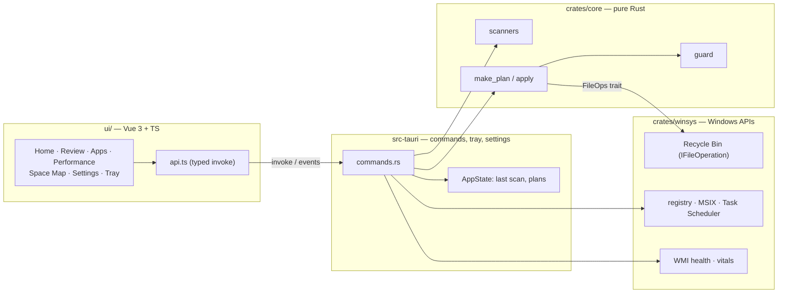

# Architecture

win-care is a [Tauri 2](https://tauri.app) app: a Rust backend that does all the work, and a
small Vue 3 + TypeScript frontend in Windows' built-in WebView2 that only renders.

## Crates

| Crate           | Job                                                                                                     | Tested with                                                                                               |
| --------------- | ------------------------------------------------------------------------------------------------------- | --------------------------------------------------------------------------------------------------------- |
| `crates/core`   | Scanners, the guard, `make_plan`/`apply`, activity log, space tree, health rules. No Windows API calls. | Fake folder trees from `Env::for_tests` and a fake `FileOps` — no test can touch a real file by accident. |
| `crates/winsys` | Implements `FileOps` with the shell; reads apps, startup items, health, vitals, known folders.          | Read-only tests against the real system, plus tiny temp files in the real Recycle Bin.                    |
| `src-tauri`     | Tauri commands, app state, settings, tray, autostart, low-disk notification, updater.                   | Unit tests for settings and pure helpers.                                                                 |

## The core flow

1. **`smart_scan`** runs the cleanup scan, lists apps and startup items and reads health. The
   findings are kept in `AppState`.
2. The UI shows them; **Review** calls `make_plan` with the ticked paths. Only paths a scan (or
   the space map) produced are accepted, so the UI cannot ask to delete an arbitrary path.
3. **`apply_plan`** takes the plan by id and calls `core::apply`, which re-checks every item (see
   [SAFETY.md](SAFETY.md)), moves it to the Recycle Bin and logs the result.

Long work runs on blocking threads (`spawn_blocking`) so the window never freezes; progress
arrives as events (`scan-progress`, `space-partial`).

## Frontend

- `ui/src/api.ts` — one typed wrapper per command; types in `types.ts` mirror the Rust structs.
- `ui/src/mock.ts` — a fake backend (`vite --mode mock`) used by the Playwright tests and for UI
  work without Rust.
- Screens other than Home load on first visit; the start-up splash is plain HTML/CSS in
  `index.html`, removed as soon as the app mounts.
- Design tokens (colours, radius, spacing) live in `ui/src/styles/tokens.css`, light and dark.

## Testing

| Layer    | Tool                                | Command              |
| -------- | ----------------------------------- | -------------------- |
| Rust     | `cargo test` + `clippy -D warnings` | `npm run check:rust` |
| UI logic | Vitest                              | `npm run test:unit`  |
| UI flows | Playwright, mocked backend          | `npm run test:e2e`   |

CI runs all of it on `windows-latest` for every push and pull request.

## Design history

The approved design and implementation plan are in `docs/superpowers/` (spec and plans); the
ChatGPT mockups that shaped the look are in `design/chatgpt/`.
